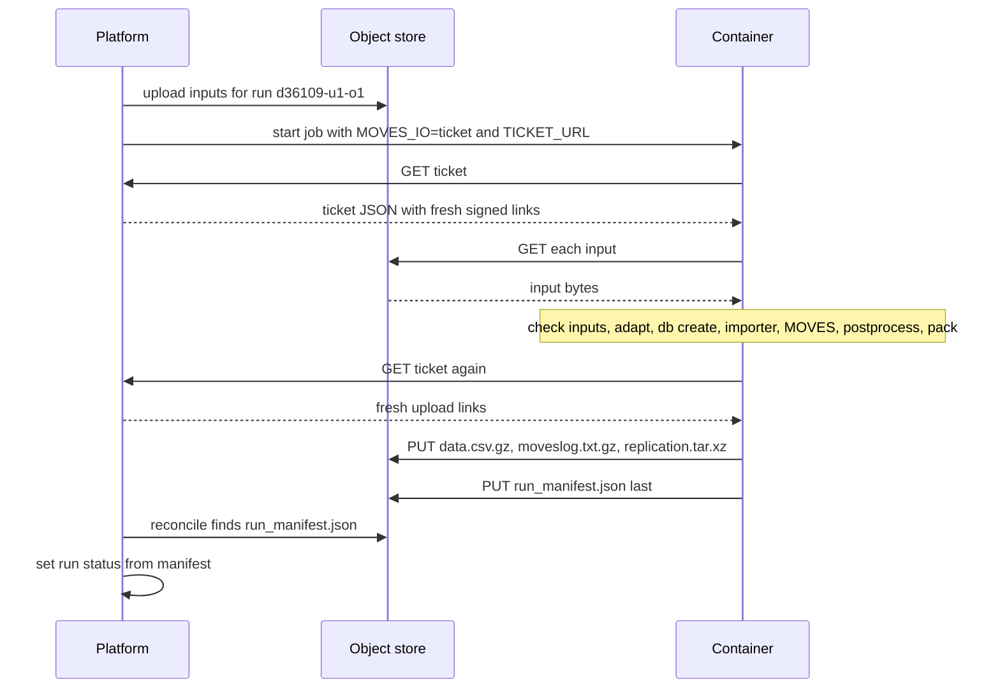

# Run tickets: how a MOVES run gets its inputs and returns its outputs

A MOVES ANYWHERE container needs two things from the outside world: the files that describe
the run (the runspec `rs_custom.xml`, `parameters.json`, and up to about 16 user CSV tables),
and somewhere to put the results. Today the container finds both in a mounted folder,
`/cat/inputs`. That works on a laptop and on a host that mounts a bucket as a disk, but it
means whoever runs the container has to hand it storage access.

A **run ticket** removes that need. The platform that orders the run gives the container one
URL, `TICKET_URL`. Fetching it returns a small JSON document listing a short-lived download
link for every input and a short-lived upload link for every output. The container downloads,
runs MOVES exactly as it does today, uploads, and writes
[`run_manifest.json`](RUN_MANIFEST.md) last. The job never holds a storage key, a database
password or a cloud credential: a ticket can only read this run's inputs and write this run's
outputs, and only until its links expire.

Three I/O modes share the same MOVES core (see [`README_scripts.md`](README_scripts.md) for the
scripts that run between fetch and push):

| `MOVES_IO` | Who it is for | Network | Credential in the job |
|---|---|---|---|
| `mounted` (default) | laptops, today's hosts, tests | none | none |
| `ticket` | user runs ordered by the platform | HTTPS to the ticket and the object store | none (a run-scoped, expiring ticket URL) |
| `sync` | archive jobs and operator tooling | the object store, via `rclone` | yes, an `rclone` remote in env |

The ticket mode is the one user runs use. `sync` exists for bulk and archive work where an
operator already holds a store credential; it is not used for user runs.

---

## For agents

Everything below is normative. "MUST", "SHOULD" and "MAY" carry their usual meaning. The
implementation is two bash scripts, `scripts/task_fetch_inputs.sh` (before
`task_check_inputs.sh`) and `scripts/task_push_outputs.sh` (after the pack step that writes
[`run_manifest.json`](RUN_MANIFEST.md)), plus a dispatcher of about ten lines in
`scripts/launch.sh`. Each script fits in about 60 lines and uses only `bash`, `curl`, `gzip`,
`tar`, `xz` and `python3 -I -c` (standard library `json` and `hashlib` only). Nothing between
fetch and push changes.

### 1. Environment contract

| Variable | Values | Default | Meaning |
|---|---|---|---|
| `MOVES_IO` | `mounted` \| `ticket` \| `sync` | `mounted` | I/O mode. Any other value: exit 5 before anything runs. |
| `TICKET_URL` | absolute URL | unset | Ticket mode only, and required there (unset: exit 5). MUST be `https://`, except `http://` to a loopback host (`127.0.0.1`, `localhost`, `[::1]`) for tests. Re-fetchable: every GET returns freshly signed links. Treat the whole URL as a secret: it carries a run-scoped token. |
| `RUN_ID` | `d{geoid}-u{user}-o{n}`, e.g. `d36109-u1-o1` | unset | Informational. Used in log lines and checked against the ticket's `run_id` (mismatch: exit 3). The manifest takes `run_id` from the ticket in ticket mode, from `RUN_ID` otherwise, else `null`. |
| `MOVES_DEBUG` | `0` \| `1` | unset | Per-run switch for MOVES debug data (keeps MOVES's worker bundles and temporary output tables; see precedence below). |
| `MOVES_SYNC_REMOTE` | `<remote>:<bucket>/<prefix>` | unset | Sync mode only, and required there (unset: exit 5). |
| `RCLONE_CONFIG_<REMOTE>_*` | rclone's env-config variables | unset | Sync mode only. The remote named in `MOVES_SYNC_REMOTE`, defined entirely in env (no config file in the image). |
| `MOVES_IMAGE`, `MOVES_IMAGE_DIGEST` | image name, `sha256:…` | unset | Set by the runner; copied into the manifest's `image` block. |

**Debug precedence.** Debug data is on for the run if `MOVES_DEBUG=1` **or**
`parameters.json` has `"debug": true`. Off by default. `MOVES_DEBUG=0` does not override a
user's `"debug": true`: the person who ordered the run asked for it. The effective value is
recorded in the manifest as `runspec.debug`.

**Logging rule.** No script logs a URL's query string, in any mode, on success or failure.
Log `scheme://host/path` only (`${url%%\?*}`), and never echo `TICKET_URL`. Signed links carry
their signature in the query string; a log line is a leak.

### 2. Ticket JSON

`GET $TICKET_URL` returns `200` with `Content-Type: application/json` and the document below.
Other responses: `401`/`403` (bad or revoked token), `404` (no such run), `410` (the run is
finished; the platform stops minting once it has a manifest). All of them mean exit 3.

The JSON Schema (draft-07):

```json
{
  "$schema": "http://json-schema.org/draft-07/schema#",
  "$id": "run_ticket.schema.json",
  "title": "MOVES ANYWHERE run ticket",
  "type": "object",
  "required": ["ticket_version", "run_id", "inputs", "outputs", "expires_at", "callbacks"],
  "additionalProperties": false,
  "properties": {
    "ticket_version": { "type": "integer", "const": 1 },
    "run_id": { "type": "string", "pattern": "^d[0-9]{2,5}-u[0-9]+-o[0-9]+$" },
    "inputs": {
      "type": "array",
      "minItems": 2,
      "items": {
        "type": "object",
        "required": ["name", "url"],
        "additionalProperties": false,
        "properties": {
          "name": { "type": "string", "pattern": "^[A-Za-z0-9][A-Za-z0-9._-]{0,99}$" },
          "url": { "type": "string", "format": "uri" },
          "sha256": { "type": "string", "pattern": "^[0-9a-f]{64}$" },
          "bytes": { "type": "integer", "minimum": 0 }
        }
      }
    },
    "outputs": {
      "type": "array",
      "minItems": 1,
      "items": {
        "type": "object",
        "required": ["name", "put_url", "content_type", "required"],
        "additionalProperties": false,
        "properties": {
          "name": { "type": "string", "pattern": "^[A-Za-z0-9][A-Za-z0-9._-]{0,99}$" },
          "put_url": { "type": "string", "format": "uri" },
          "content_type": { "type": "string" },
          "headers": {
            "type": "object",
            "additionalProperties": { "type": "string" }
          },
          "required": { "type": "boolean" }
        }
      }
    },
    "expires_at": { "type": "string", "format": "date-time" },
    "callbacks": { "type": "array", "maxItems": 0 }
  }
}
```

Field rules:

- `ticket_version`: the container accepts exactly the versions it knows (today `1`); any
  other value is exit 3. A breaking change bumps it.
- `inputs[].name`: a bare file name (the pattern forbids `/` and a leading `.`). The file
  lands at `/cat/inputs/<name>`. The list MUST contain `rs_custom.xml` and `parameters.json`;
  it MAY contain `importer.xml` and the user's CSV tables. Names starting with `_` are
  reserved for the adapted tables `task_adapt.R` writes and MUST NOT appear.
- `inputs[].sha256`, `inputs[].bytes`: optional. When present the container verifies them.
- `outputs[].headers`: optional extra request headers some object stores need on an upload
  (for example an upsert flag). Sent verbatim; never logged.
- `outputs[].required`: `true` means the run cannot be `ok` unless this PUT returned 2xx.
- `expires_at`: the earliest expiry of any link in the ticket (UTC, RFC 3339). Some object
  stores give upload links a fixed lifetime (two hours, not configurable) while download links
  take a chosen expiry; the platform reports the minimum.
- `callbacks`: always an empty array. There is no webhook. **The manifest is the callback**:
  the platform learns the run finished when `run_manifest.json` lands.

**Output names.** The platform lists, and the container pushes, exactly these objects:

| Mode (`parameters.json` `mode`) | Output names | `required` |
|---|---|---|
| inventory (`inv`) | `data.csv.gz` | true |
| rate (`rates`) | `rateperhour.csv.gz`, `ratepervehicle.csv.gz`, `rateperdistance.csv.gz`, `rateperstart.csv.gz`, `startspervehicle.csv.gz`, `rateperprofile.csv.gz`, `movesrun.csv.gz` | true (they replace `data.csv.gz`) |
| both | `moveslog.txt.gz` | true |
| both | `replication.tar.xz` | true |
| both | `run_manifest.json` | true, and always PUT last |

The container pushes a listed output only if it produced it, and never pushes a file the
ticket does not list (anything else it made goes inside `replication.tar.xz`). If a listed
output was not produced, the run is `failed`.

A filled example (signatures elided):

```json
{
  "ticket_version": 1,
  "run_id": "d36109-u1-o1",
  "inputs": [
    { "name": "rs_custom.xml", "url": "https://store.example.org/in/rs_custom.xml?token=REDACTED", "bytes": 10240 },
    { "name": "parameters.json", "url": "https://store.example.org/in/parameters.json?token=REDACTED", "sha256": "9f2c1a0e5b7d4c3a8e6f1b2d0c9a7e5f3b1d2c4a6e8f0b9d7c5a3e1f2b4d6c8a" },
    { "name": "vmt.csv", "url": "https://store.example.org/in/vmt.csv?token=REDACTED" }
  ],
  "outputs": [
    { "name": "data.csv.gz", "put_url": "https://store.example.org/out/data.csv.gz?token=REDACTED", "content_type": "application/gzip", "required": true },
    { "name": "moveslog.txt.gz", "put_url": "https://store.example.org/out/moveslog.txt.gz?token=REDACTED", "content_type": "application/gzip", "required": true },
    { "name": "replication.tar.xz", "put_url": "https://store.example.org/out/replication.tar.xz?token=REDACTED", "content_type": "application/x-xz", "required": true },
    { "name": "run_manifest.json", "put_url": "https://store.example.org/out/run_manifest.json?token=REDACTED", "content_type": "application/json", "required": true }
  ],
  "expires_at": "2026-11-02T20:15:00Z",
  "callbacks": []
}
```

Parsing in bash, one record per line (tab-separated, empty field when absent):

```sh
python3 -I -c 'import json,sys; t=json.load(open(sys.argv[1]))
for i in t["inputs"]: print(i["name"], i["url"], i.get("sha256",""), i.get("bytes",""), sep="\t")' ticket.json
```

### 3. Fetch phase (`task_fetch_inputs.sh`, ticket mode)

1. `mkdir -p /cat/inputs`. GET the ticket into a file outside `/cat/inputs`
   (e.g. `/cat/run/ticket.json`, mode 600). Validate: parses as JSON, `ticket_version` known,
   `run_id` matches `RUN_ID` when `RUN_ID` is set, `rs_custom.xml` and `parameters.json`
   listed, every name matches the name pattern. Any failure: exit 3.
2. For each input: `curl -fsS --retry 0 -o /cat/inputs/<name>.part <url>`, then verify
   `bytes` and `sha256` when given, then `mv` the `.part` file to `<name>`. A file is never
   left at its final name unverified.
3. **Retries.** Up to 3 attempts per file with backoff of 2, 4 and 8 seconds. Connection
   errors, `408`, `429` and `5xx` are retried as they are. On `400`, `401`, `403` or `404`
   the container re-fetches the ticket once (the link may have expired) and retries with the
   fresh link. After the third failure, or on a checksum mismatch after a fresh download:
   **fail closed**, exit 2. MOVES never starts on a partial input set.
4. Hand over to `task_check_inputs.sh` unchanged.

On a fetch failure (exit 2) the container still runs the push phase (§4) with a `failed`
manifest whose `stop_reason` names the file and HTTP status, e.g.
`input fetch failed: vmt.csv HTTP 404`. On an unusable ticket (exit 3) there is no trusted
place to write, so nothing is pushed; the platform falls back to the runner's job status.

### 4. Push phase (`task_push_outputs.sh`, ticket mode)

1. **Re-fetch the ticket** before pushing. A run takes about 30 minutes; upload links minted
   at the start may have expired. A failed re-fetch is retried as in §3.3, then exit 4.
2. For each output in the ticket **except** `run_manifest.json`, in ticket order: if the
   local file exists, `curl -fsS -X PUT -H "Content-Type: <content_type>" [-H <headers>...]
   --data-binary @<file> <put_url>`, with the retry rule of §3.3 (a `400`/`401`/`403`
   re-fetches the ticket once). Record each 2xx.
3. The manifest is assembled after step 2 so it can state the true outcome: `status: ok` only
   if the MOVES pipeline succeeded **and** every `required: true` output other than the
   manifest returned 2xx. Otherwise `status: failed` with a `stop_reason` such as
   `push failed: data.csv.gz HTTP 403`. Its `outputs` list names only objects that were
   actually stored.
4. **`run_manifest.json` is PUT last**, once, after every other PUT has finished. A failed run
   still PUTs a manifest (`status: failed`). If the manifest PUT itself fails after retries,
   exit 4: the platform sees no manifest and uses the runner's job status and its own timeout.
5. Re-running a ticket overwrites the same objects. The platform signs upload links that
   allow replacing an existing object.

### 5. Mounted mode (default)

No network, no ticket. Inputs are read from the mounted `/cat/inputs` exactly as today, and
every file the scripts write today (`movesoutput.csv`, `movesactivityoutput.csv`, `data.csv`,
`moveslog.txt`, `diagnostics.txt`, the adapted `_*.csv`) is still written there, unchanged.
The pack step additionally writes the outputs of §2 (`data.csv.gz`, `moveslog.txt.gz`,
`replication.tar.xz`) into `/cat/inputs/`, then `run_manifest.json` last. Nothing is deleted.

### 6. Sync mode (archive and tooling only)

For operators and bulk jobs that already hold a store credential; never used for user runs,
because the job then carries that credential.

- Remote: `MOVES_SYNC_REMOTE=<remote>:<bucket>/<prefix>`; the remote is defined only by
  `RCLONE_CONFIG_<REMOTE>_TYPE` and its sibling variables (rclone's documented env config).
  No rclone config file is baked into the image or written to disk.
- Fetch: `rclone copy "$MOVES_SYNC_REMOTE/in" /cat/inputs`, 3 attempts, then exit 2.
- Push: `rclone copy /cat/out "$MOVES_SYNC_REMOTE/out" --exclude run_manifest.json`, then
  `rclone copyto /cat/out/run_manifest.json "$MOVES_SYNC_REMOTE/out/run_manifest.json"` last.
  Failure: exit 4. Same output names and the same manifest-last rule as ticket mode.
- `rclone` is run with `--config /dev/null` so env vars are the only source.

### 7. Exit codes

| Code | Meaning | Manifest written? |
|---|---|---|
| 0 | run `ok`, every required output and the manifest stored | yes, `ok` |
| 1 | the MOVES pipeline failed (any task script between fetch and pack; today's scripts exit 1) | yes, `failed` |
| 2 | input fetch failed: HTTP error after 3 attempts, or checksum or size mismatch | yes, `failed`, if a ticket was obtained |
| 3 | ticket unusable: unreachable after retries, non-2xx, bad JSON, unknown `ticket_version`, `run_id` mismatch, missing required input names | no |
| 4 | push failed: a required output or the manifest could not be stored, or the pre-push ticket re-fetch failed | `failed` if the manifest PUT works; otherwise no |
| 5 | configuration error: unknown `MOVES_IO`, missing `TICKET_URL` or `MOVES_SYNC_REMOTE`, non-HTTPS non-loopback `TICKET_URL` | no |

When more than one applies, the first failure wins (a run that fails in MOVES and then fails
to push exits 1; the manifest says why).

### 8. Sequence



### 9. Testing with a local stub ticket server

The U1.2 test runs the container against a stub on the host, no cloud involved. Lay out a
directory `stub/` with `in/` (the run's inputs, e.g. a copy of `inputs_ny/` minus outputs and
`_*.csv`), an empty `out/`, and `ticket.json` whose links point at the stub, e.g.
`http://127.0.0.1:8765/in/rs_custom.xml` and `http://127.0.0.1:8765/out/data.csv.gz`. Run the
stub from `stub/`:

```python
import http.server, os, sys
class H(http.server.SimpleHTTPRequestHandler):
    def do_GET(self):
        if self.path.split("?")[0] == "/ticket":
            self.path = "/ticket.json"
        return super().do_GET()
    def do_PUT(self):
        name = os.path.basename(self.path.split("?")[0])
        n = int(self.headers.get("Content-Length", 0))
        with open(os.path.join("out", name), "wb") as f:
            f.write(self.rfile.read(n))
        self.send_response(200); self.end_headers()
        with open("put_order.log", "a") as f:
            f.write(name + "\n")
http.server.ThreadingHTTPServer(("127.0.0.1", int(sys.argv[1])), H).serve_forever()
```

Start it with `python3 -I stub.py 8765`, then run the container with `--network host`,
`MOVES_IO=ticket`, `TICKET_URL=http://127.0.0.1:8765/ticket?t=test` and `RUN_ID`. The test
passes when:

- every listed input arrived and checked out, and the run reached the push phase;
- `out/` holds the four objects of §2 and `put_order.log` ends with `run_manifest.json`;
- `out/run_manifest.json` validates against [`RUN_MANIFEST.md`](RUN_MANIFEST.md) and says `ok`;
- the per-key sums in `data.csv.gz` match a mounted-mode run of the same inputs exactly;
- `docker exec <id> env` during the run shows no key, password or token other than
  `TICKET_URL`, and the container's stdout contains no `?` from a link's query string.

Failure cases to script: a `404` on one input (exit 2, `failed` manifest naming the file); a
stub that returns `403` on the first PUT and `200` after a ticket re-fetch (exit 0); a ticket
with `"ticket_version": 2` (exit 3).
